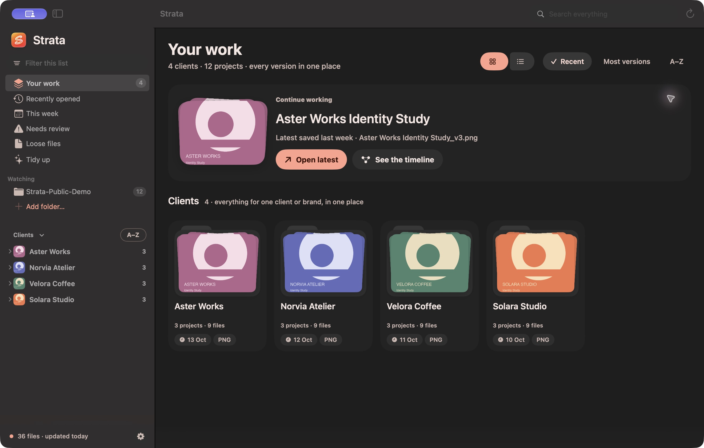
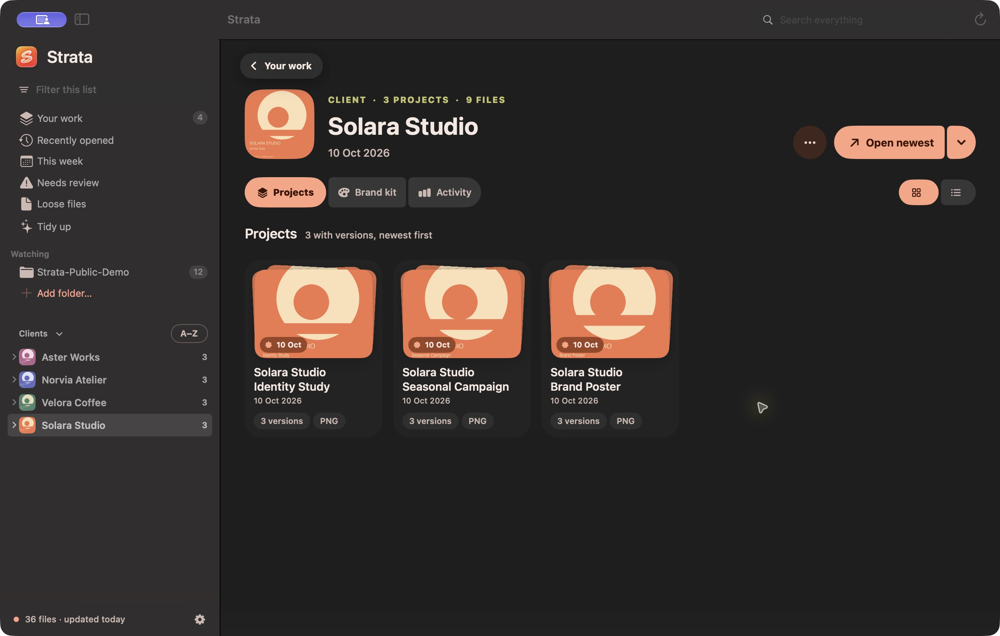
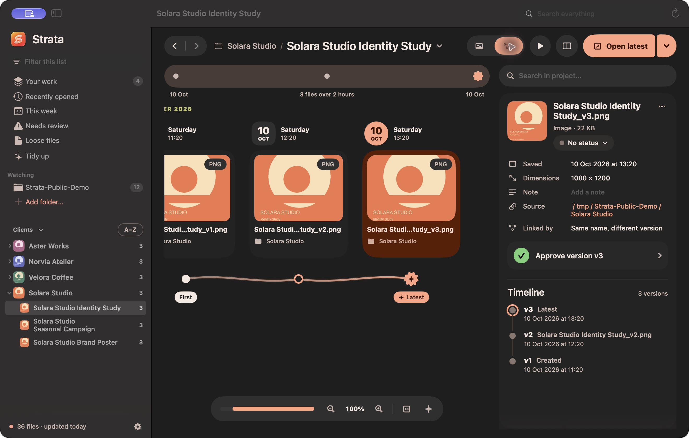

<p align="center"></p>

# Strata

**Your creative work, every version, in one place.**

Strata is a native macOS workspace for designers and creative professionals. It brings scattered working files, recovered copies, and exports together by client and project, so you can find the latest work, explore its history, compare versions, and prepare a delivery without reorganizing your folders.

Built with SwiftUI and AppKit. Local indexing. No account required. Open for community development.

[Download for macOS](https://github.com/hachimkf/strata/releases/latest) · [Report a bug](https://github.com/hachimkf/strata/issues) · [Contribute](CONTRIBUTING.md) · [MIT license](LICENSE)



## Features

- **Client workspaces** — visual collections of projects, loose files, and a client brand kit.
- **Version history** — a zoomable timeline with pan, pinch, keyboard navigation, and history replay.
- **Visual comparison** — side by side, slider, overlay, and difference modes with linked zoom.
- **Conservative grouping** — names, version markers, folder context, Adobe metadata, and exact duplicate detection, with manual corrections taking priority.
- **Find your work** — in-app search with ⌘K, a menu bar panel, and a configurable global search shortcut (default ⇧⌘B).
- **Review tools** — version notes and statuses saved as Finder tags, plus a Needs review view.
- **Brand kits** — artwork colors, fonts extracted from Adobe metadata, and logo files gathered per client.
- **Delivery packages** — ZIP the latest source and exports for a project or client.
- **Tidy up** — review exact duplicates and crash copies before moving selected files to the Trash.
- **Personalize** — light, dark, or system appearance; accents; optional artwork colors; reduced motion; and watched folders.
- **Stay current** — optional automatic update checks and verified installer downloads.

### Client workspace



### Project timeline



Screenshots show the running app. Artwork shown is demonstration content and is not included in the software license or downloads.

## Download and install

Requires **macOS 14 or later**. Release builds contain **Apple Silicon and Intel** binaries.

1. Download `Strata-<version>.dmg` from [Releases](https://github.com/hachimkf/strata/releases/latest).
2. Open the disk image and drag **Strata** to **Applications**.
3. Launch Strata and choose the folders you want it to watch. Allow macOS folder access when requested.

A `.pkg` installer is also available and is used by the in-app updater. Existing users can check **Settings → General → Check for updates**.

**Early community release:** the current distribution is not notarized by Apple. macOS may block first launch; only allow it through Privacy & Security if you trust this release, or build it from source. Preview support depends on the file format and macOS Quick Look providers; some files can show a generic icon. Grouping is heuristic and can need manual corrections. Strata tracks existing files; it does not create a backup or capture every save.

## Privacy and file safety

Your creative files stay on your Mac. Indexing and grouping run locally. There is no cloud account or file upload. Optional update checks contact GitHub; you can disable them in Settings.

Scanning does not move or rename originals. Actions such as setting Finder tags, preparing a delivery, or moving duplicates to the Trash happen when you request them. Local metadata and corrections live under `~/Library/Application Support/Strata/`.

## Build and run

Use a **Swift 6 toolchain** on macOS (Xcode or Command Line Tools). No third-party package dependencies are required.

```bash
git clone https://github.com/hachimkf/strata.git
cd strata
Scripts/build-app.sh --open
```

The app is built at `build/Strata.app`. To build both supported architectures:

```bash
Scripts/build-app.sh --universal
```

Run the core checks and optional scanner:

```bash
swift run strata-selftest          # 20 grouping/scanner checks
swift run -c release strata-scan   # inspect local grouping; output can contain private paths
```

## How files are grouped

| Signal | Example |
| --- | --- |
| Same Adobe **DocumentID** | `logo.ai` and `logo (Recovered).ai` |
| Same Adobe **OriginalDocumentID** (Save As family) | `atlas_v2.ai` → `atlas_final.ai` |
| **DerivedFrom** (export → source) | `export-01.png` from `atlas_final.ai` |
| Same name after cleanup | `Atlas Logo final final (Recovered) 2.ai` = `atlas_logo_FINAL_v2.ai` |
| Identical bytes | `promo.mp4` and `promo (1).mp4` → flagged as duplicate |

Guards learned from real folders:
- Adobe IDs only link files whose **names agree** — designers often Save As last month's file to start a new job.
- Generic names (`Untitled-1`, `Screenshot…`, `IMG_1234`, `ChatGPT Image…`) never form projects on their own.
- A file name repeated across many folders (`01_Product/photos/room.jpg`, `02_Product/photos/room.jpg`) is a naming convention; those are split by their parent folder name.

## Clients (collections)

Projects and stray files are then gathered into clients:

- **Client folder**: the first meaningfully named folder under a watched root (`~/Documents/Atlas Studio`). A project spread over two clients' folders counts for the one holding most of its files.
- **Brand word**: a made-up or foreign word that starts names in several places (`Atlas …`, `Nomad …`). Ordinary English words (`left`, `grid`) never count; spelling variants sharing 6 letters merge when the collector considers them the same brand; a folder named after a brand joins it.
- **Adobe family**: only adopts files with no client of their own — designers start one client's file from another's.

`swift run -c release strata-scan --collections` prints the clients found. `STRATA_EDGES=/tmp/edges.tsv` logs every link for debugging.

## Layout

- `Sources/StrataCore` — scanner (FSEvents watcher, XMP reader, metadata cache) and the grouping engine. No UI.
- `Sources/Strata` — SwiftUI app: project grid, version timeline, inspector, menu bar panel.
- `Sources/strata-scan`, `Sources/strata-selftest` — command-line tools.

Note: the macOS 27 SDK turns `@State` into a macro that only ships with Xcode, so views use `@ViewState` (a typealias of the same property wrapper, in `Support.swift`).

## Development and contributions

Bug reports, design feedback, documentation improvements, and pull requests are welcome. Start with [CONTRIBUTING.md](CONTRIBUTING.md). Useful areas include grouping edge cases, preview reliability, accessibility, performance on large libraries, and workflow polish. Use synthetic file names and artwork when sharing reproduction cases.

## Release tooling

```bash
Scripts/build-app.sh --universal
Scripts/make-dmg.sh                        # drag-to-Applications disk image
Scripts/release.sh patch "What changed"     # maintainer: build, sign, package, tag and publish
Scripts/release.sh current "" --local       # build artifacts without publishing
```

Release automation publishes the DMG, PKG, and checksums to this repository and mirrors downloads to [strata-releases](https://github.com/hachimkf/strata-releases) for compatibility with installed apps. The updater currently selects the PKG and its `.sha256`; the DMG checksum is named `.dmg.sha256.txt` to avoid ambiguity.

Signing uses `STRATA_SIGN_IDENTITY` or a locally available certificate, falling back to ad-hoc signing. No signing credentials are included. Notarization requires a Developer ID Application certificate, a Developer ID Installer certificate for the PKG, and a Keychain profile set with `STRATA_NOTARY_PROFILE`. See the scripts for the maintainer workflow.

## License

Strata's source code is available under the [MIT license](LICENSE). Screenshots illustrate the application; depicted third-party artwork, client marks, and trademarks retain their respective rights.
